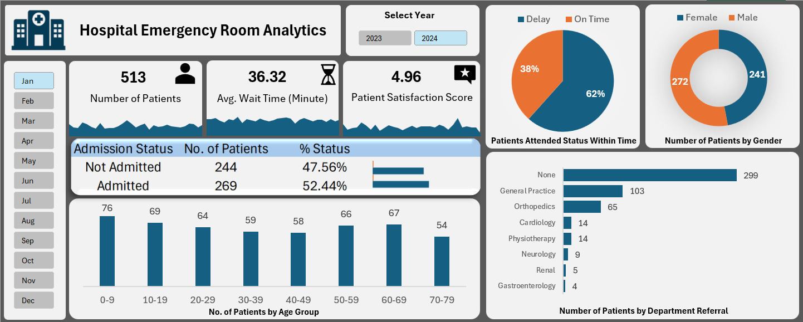

# Hospital Emergency Room Analytics — Excel Dashboard

An interactive Excel dashboard analyzing 9,216 emergency room patient records (Apr 2023 – Oct 2024) — covering patient volume, wait times, satisfaction, admissions, demographics and department referrals.

## 📊 Project Overview

This project turns raw ER visit data into a decision-ready dashboard, answering key operational questions:

- How many patients visit the ER each month, and how does it trend?
- What is the average wait time, and are patients attended on time?
- How many patients are admitted vs not admitted?
- Which age groups and genders visit most?
- Which departments receive the most referrals?
- How do satisfaction scores trend over time?

## 📁 Dataset

`Hospital_Emergency_Room_Data.csv` — 9,216 patient records with the following fields:

| Column                     | Description                                   |
| -------------------------- | --------------------------------------------- |
| Patient Id                 | Unique patient identifier                     |
| Patient Admission Date     | Date and time of ER visit                     |
| Patient First Initial / Last Name | Patient name fields                    |
| Patient Gender             | Gender of the patient                         |
| Patient Age                | Age in years                                  |
| Patient Race               | Race / ethnicity of the patient               |
| Department Referral        | Department the patient was referred to        |
| Patient Admission Flag     | Whether the patient was admitted (TRUE/FALSE) |
| Patient Satisfaction Score | Score from 0 to 10 (not given by all patients)|
| Patient Waittime           | Wait time in minutes                          |

## 📈 Dashboard Features

- **KPI cards** — Number of Patients, Average Wait Time (minutes), Patient Satisfaction Score, each with a trend sparkline
- **Slicers** — filter the whole dashboard by Year (2023 / 2024) and Month
- **Patients Attended Status Within Time** — pie chart of delayed vs on-time patients
- **Number of Patients by Gender** — donut chart
- **Admission Status** — admitted vs not admitted, with patient count and % share
- **Number of Patients by Age Group** — column chart across 10-year age bands
- **Number of Patients by Department Referral** — bar chart
- **Daily trend sheets** — daily ER patients, average wait time and satisfaction score

## 🛠️ Tech Stack

- Microsoft Excel
- PivotTables (12) and PivotCharts
- Slicers for interactive filtering
- Dashboard design with KPI cards and sparklines

## 🚀 How to Use

1. Download `PD-Portfolio Dashboard.xlsx` and open it in Microsoft Excel (desktop version recommended for slicers).
2. Go to the **Dashboard** sheet.
3. Use the **Year** and **Month** slicers to filter all KPIs and charts.
4. The **Pivot Report** sheet holds the PivotTables behind each visual.

## 📌 Key Insights

- Overall average wait time is about **35 minutes** (maximum 60 minutes)
- About **50%** of ER patients are admitted
- Roughly **41%** of patients are referred to a department; **General Practice** and **Orthopedics** receive the most referrals
- Patient volume is much higher from April to October than from November to March (the data starts in April 2023, so the 2023 months are partial)
- Satisfaction scores are recorded for only about 27% of patients, so satisfaction results should be read with that in mind

## 📈 Possible Extensions

- Add peak-hour analysis to plan staffing around busy time slots
- Add a Power BI version of the same dashboard
- Compare wait time against satisfaction score to see if long waits lower ratings

## 👤 Author

**Pavan Dev Sharma**
[LinkedIn](https://linkedin.com/in/pavan-dev-sharma-2439a1250) | [GitHub](https://github.com/pavandevsharma06)
